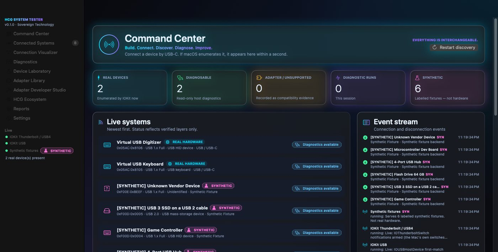

# HCG System Tester

**Modular system connectivity, hardware discovery and diagnostics for macOS.**
Hakmi Capital Group · `com.hakmicapitalgroup.systemtester` · version 0.3.0 · LifeOS realm: Sovereign Technology

> **EVERYTHING IS INTERCHANGEABLE.** Build. Connect. Discover. Diagnose. Improve.

Connect a device to your Mac through USB-C, USB-A (through an adapter), a hub or Thunderbolt. HCG System Tester finds it through
macOS's own IOKit registry and shows what it is. It also shows exactly how far communication actually goes:

| Layer | What it proves |
|---|---|
| Physical | An electrical data link exists |
| Enumeration | macOS read the device's descriptors |
| Protocol compatibility | A driver or adapter can speak one of its protocols |
| Authorization | You (and the device, where needed) authorised a session |
| Functional communication | Data was actually exchanged |

A recognised name or USB ID only ever results in **Identified**. A device is only shown as **Connected** after it has actually
exchanged data. Unknown devices are shown with their raw descriptors and are never assumed to support anything.



*Command Center on a CI Mac: two real (virtual) USB devices discovered by IOKit, plus opt-in fixtures labelled SYNTHETIC.
More screenshots and CI results are in [docs/TEST-RESULTS.md](docs/TEST-RESULTS.md).*

## New in 0.3.0: Universal Connectivity

- **Universal Connectivity Center** with 25 categories (computers, phones, consoles, TVs, vehicles, agricultural and
  industrial equipment, robotics, drones, microcontrollers, sensors, smart home, radio …) and user-started discovery:
  USB/Thunderbolt (IOKit), Bluetooth LE scan, paired Bluetooth Classic, Bonjour and SSDP. Nothing runs at launch.
- **Device Connectivity Encyclopedia**: 17 structured profiles (PS5, Samsung Smart TV, Audi R8, John Deere, ISOBUS,
  industrial arms, ROS 2, DJI, Raspberry Pi, Arduino, ESP32, iPhone/iPad, Mac, Windows, Linux, BLE sensors, Matter/HomeKit).
  Every fact is labelled *Manufacturer*, *Community*, *AI suggestion*, *HCG verified* or *HCG note*. Your own profiles load from JSON.
- **Protocol Registry** (27 protocols, discovery and communication declared separately), **Hardware Requirements Center**,
  **14-step Connection Studio** with single-use approval and read-only drivers (USB re-read, Apple CoreDevice, BLE GATT
  Device Information/Battery read, UPnP description, Samsung TV `:8001/api/v2/`).
- **Living Development Roadmap** (17 states) that updates itself only from real-hardware evidence or your physical-test
  reports; manual decisions are recorded with notes and history. **Gap Analyzer** with stable IDs, dependencies, priorities
  and **proposed LifeOS quests** (no XP, never auto-completed). **Compatibility Matrix**, **Connection History**,
  **AI Connection Assistant** (rule-based, labelled *not AI*; HCG AI availability check; redacted research request).
- Vehicles, machinery, robots and drones are **read-only research**; control is prohibited.
  → [docs/UNIVERSAL-CONNECTIVITY.md](docs/UNIVERSAL-CONNECTIVITY.md) · [12-step acceptance test](docs/CONNECTIVITY-ACCEPTANCE.md)

| Capability (0.3.0) | Status |
|---|---|
| USB enumeration evidence, profile matching, roadmap, gaps, LifeOS export | ✅ implemented, unit-tested, CI-verified with the runner's real virtual USB devices |
| Bluetooth LE scan + allow-listed GATT read, Bonjour, SSDP, Samsung TV info | ⚙︎ implemented; **awaiting physical verification on your Mac** (CI runners have no radio or LAN devices) |
| PS5, Samsung TV, Audi R8, agricultural, robotics, drone profiles | 📚 research profiles — no compatibility claimed |
| HCG AI assistant chat | ⏳ blocked: no native client issued for System Tester; handoff answers `not_published` |

## New in 0.2.0: Device Intelligence

- **Apple Device Intelligence Adapter.** Connect an iPhone or iPad over USB-C. System Tester correlates the IOKit USB
  device with Xcode's CoreDevice (`xcrun devicectl … --json-output`) and shows the real model, product type, iOS version
  and build, storage capacity, pairing status, Developer Mode, services and response latency. Every field shows its
  source; every missing field says why. Battery level and free space come from optional libimobiledevice.
  → [docs/APPLE-ADAPTER.md](docs/APPLE-ADAPTER.md) · [iPhone acceptance test](docs/IPHONE-ACCEPTANCE.md)
- **13-state connection ladder** (waiting → … → diagnostics available / limited / unsupported / disconnected) with
  evidence for each step and the next available action. Guided Trust/pairing uses Apple's own flow and never bypasses it.
- **Device Intelligence workspace** with Overview (illustration, state, capabilities, timeline), Hardware, Software
  (incl. installed apps on request), Diagnostics, Authorization, Activity and Reports tabs.
- **Live Device Monitor** (uptime, availability, latency graphs, drop-outs, configurable intervals),
  **USB Connection Inspector** (charging-only vs data vs host-to-host vs enumerated vs functional), **Visualizer 2.0**,
  11 Apple diagnostics, Studio reference implementation and fixture editor, prepared HCG Server and Sentinel exports.

| Capability | Status |
|---|---|
| IOKit USB/Thunderbolt discovery, identification, host diagnostics | ✅ implemented, verified on CI and on your MacBook (0.1.0) |
| Apple adapter (devicectl/CoreDevice, pairing flow, Apple diagnostics) | ✅ implemented and tested against fake devicectl output; **awaiting physical iPhone/iPad verification** |
| Battery level / free space | ⚙︎ only with optional libimobiledevice, after pairing |
| Synthetic iPhone fixture | 🧪 simulated, labelled SYNTHETIC everywhere |
| Android, consoles, appliances, network, microcontrollers… | 🔜 planned; no support is claimed |

## Quick start (MacBook Pro, Apple silicon, Xcode)

```bash
git clone https://github.com/F1r3srp3nt/HCG-System-Tester.git
cd HCG-System-Tester
open App/HCGSystemTester.xcodeproj      # then press ⌘R
```

Plug in any USB device: it appears in the **Command Center** within about a second. Unplug it, and the disconnection is recorded.

**Without opening Xcode:**

```bash
scripts/build-app.sh --open             # builds dist/HCG System Tester.app (ad-hoc signed) and launches it
```

**From the terminal only:**

```bash
swift run hcg-probe --watch             # live attach/detach stream
swift run hcg-probe --diagnose          # list + read-only diagnostics on every device
swift run hcg-probe --toolchain         # what your Xcode / devicectl supports
swift run hcg-probe --apple             # Apple Device Intelligence for a connected iPhone / iPad
swift run HCGSystemTester               # launch the full app from SwiftPM
```

See [docs/BUILD.md](docs/BUILD.md) for details and troubleshooting.

## What 0.1.0 contains

| Area | Status |
|---|---|
| Real USB discovery (IOKit `IOUSBHostDevice`, first-match + terminated notifications) | ✅ live |
| Thunderbolt / USB4 switch discovery (`IOThunderboltSwitch`) | ✅ live (switch-level) |
| Interfaces, drivers, BSD disks, serial `/dev/cu.*` nodes, link speed, topology | ✅ live |
| Universal Device Identification Engine (40+ profiles, confidence + evidence) | ✅ |
| Five-layer connectivity assessment + lifecycle state machine | ✅ |
| Hardware Adapter SDK (`hcg.adapter-manifest/1`), validator, registry, 11 first-party adapters | ✅ |
| Diagnostic Engine: 14 host operations, authorisation gate, audit log | ✅ read-only |
| Device Laboratory: profiles, history, sessions, timelines, comparison, compatibility evidence | ✅ |
| Connection Visualizer (animated, built from discovery data only) | ✅ |
| Adapter Developer Studio (manifest/profile editors, validation, synthetic testing, versions, import/export) | ✅ |
| Reports: Markdown, JSON, HCG Device Link `hcg.diagnostic-report/1` | ✅ redacted |
| Synthetic fixtures (opt-in, labelled SYNTHETIC everywhere) | ✅ |
| HCG ecosystem panel (Server, Terminal, Sentinel, Nexus, Connect, Signal Contractor, Executable Maker) | ✅ contracts only |
| Serial sessions, network/Bluetooth discovery, IoT, Device Link pairing, HCG Connect sign-in | 🔜 [roadmap](docs/ROADMAP.md) |

## Repository layout

```
Package.swift                 SwiftPM package (the single source of truth for code)
Sources/HCGCore               Platform-neutral engine: models, identification, adapters, diagnostics, lab, reports, redaction
Sources/HCGHardware           IOKit discovery backends (macOS)
Sources/HCGSystemTesterUI     SwiftUI workstation (10 sections)
Sources/HCGSystemTester       SwiftPM app executable
Sources/hcg-probe             Command-line probe
Tests/                        XCTest suites (core + live hardware smoke tests)
App/                          Native Xcode project (app target linking the package)
Packaging/, AppPackaging.json HCG Executable Maker packaging contract (hcg-app-packaging/1)
scripts/build-app.sh          Builds the .app from the package without Xcode
Examples/Adapters             SDK example manifest
docs/                         Architecture, SDK, testing, limitations, ecosystem, roadmap, LifeOS import
```

## Documentation

- [Build & run on macOS](docs/BUILD.md)
- [Universal Connectivity](docs/UNIVERSAL-CONNECTIVITY.md) · [12-step connectivity acceptance test](docs/CONNECTIVITY-ACCEPTANCE.md)
- [iPhone 16 Pro Max acceptance test](docs/IPHONE-ACCEPTANCE.md)
- [Apple Device Intelligence Adapter](docs/APPLE-ADAPTER.md)
- [Physical-device test checklist](docs/PHYSICAL-TESTING.md)
- [Test results (CI)](docs/TEST-RESULTS.md)
- [Actual hardware compatibility limitations](docs/HARDWARE-LIMITATIONS.md)
- [Architecture](docs/ARCHITECTURE.md)
- [Hardware Adapter SDK](docs/ADAPTER-SDK.md)
- [HCG ecosystem integration](docs/ECOSYSTEM.md)
- [Security & privacy](docs/SECURITY.md)
- [Roadmap & milestones](docs/ROADMAP.md) · [proposed LifeOS import](docs/lifeos/hcg-system-tester.backlog.json)

## Safety principles

- Discovery is **read-only**. No drivers are installed, no administrator privileges are requested, and no device is modified.
- Imported adapters are **declarative data**. They can only compose host-implemented operations, they start untrusted and
  disabled, and they never run until you approve them.
- Extended tests need confirmation. State-changing operations need explicit authorisation for each device and each operation.
  Every decision is written to an audit log.
- Serial numbers, user paths, network identifiers and credentials are redacted from reports and logs.
- No console, phone or appliance security control is ever bypassed.
- Bluetooth, Bonjour and SSDP discovery start only when you press a button; connecting needs a single-use approval and is
  read-only. Vehicle, machinery, robot and drone control, firmware flashing and radio transmission are never performed.
- AI output is labelled and never changes state, devices or files; nothing is sent to HCG AI.
- Publication to HCG Store, GitHub Releases or any other channel is a manual decision. This repository only builds.
