# Test results — 0.3.0 Universal Connectivity

CI run 18 on a GitHub `macos-15` runner (commit `14e2401`): debug build, **86 XCTest tests, 0 failures**, read-only probes,
release app bundle, UI snapshots, Xcode project build — all green.

`hcg-probe --connectivity --ssdp` on the runner (real, unedited):

```
Universal Connectivity — 17 profiles · 27 protocols · discovery only, nothing is connected
  Virtual USB Keyboard (Real hardware) → no profile match (discovered only)
  Virtual USB Digitizer (Real hardware) → no profile match (discovered only)
Equipment detected on this Mac:
  cable.usbc-data: Detected — Inferred: 2 USB device(s) enumerated, so a data-capable link exists. …
  interface.wifi-or-ethernet: Detected — Active interface(s): en0 (Ethernet)
SSDP: 0 responder(s)
```

What this shows: real devices that match no profile stay *discovered only* (nothing is invented); equipment is reported
only where evidenced; the runner's isolated network has no UPnP devices. The roadmap recorded a genuine automatic
transition (*Hardware required → Ready for connection*) once the Ethernet interface was detected.

**Not verifiable on CI** (no Bluetooth radio, no LAN devices, no iPhone): acceptance steps 2, 3, 4, 6 (physical part)
and 10 (physical part) — see [CONNECTIVITY-ACCEPTANCE.md](CONNECTIVITY-ACCEPTANCE.md). They are pending on your Mac.

| Universal Connectivity Center | Connection Studio (synthetic iPhone fixture) |
|---|---|
| 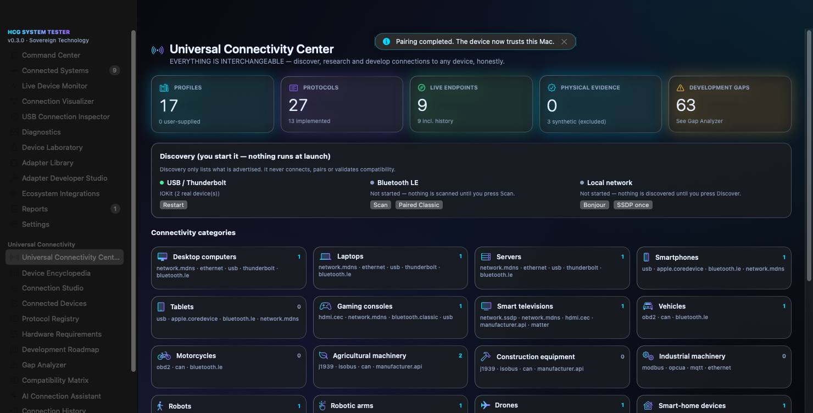 | 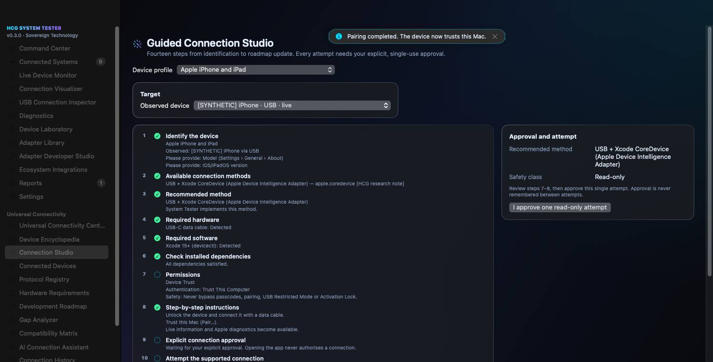 |
| Audi R8 research profile | John Deere in the Studio (what must be developed) |
| 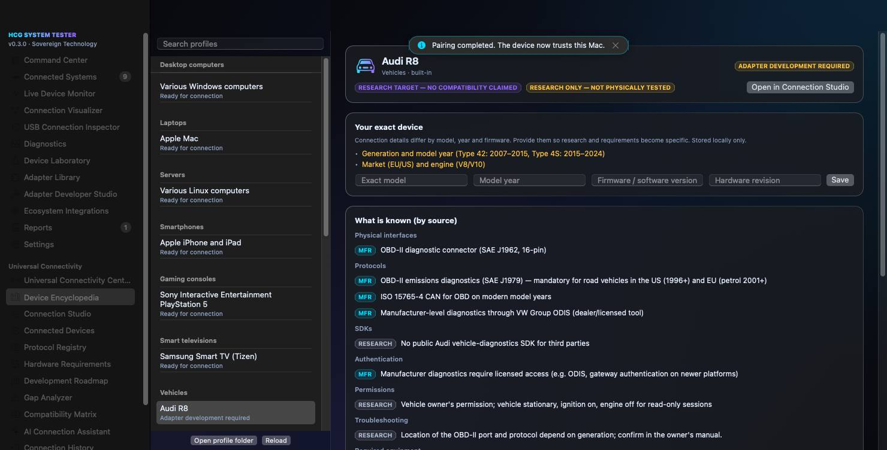 | 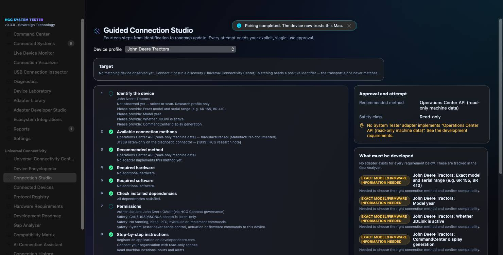 |
| Development Roadmap (automatic history) | Compatibility Matrix (research vs real evidence) |
| 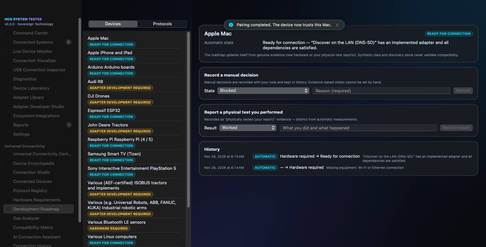 | 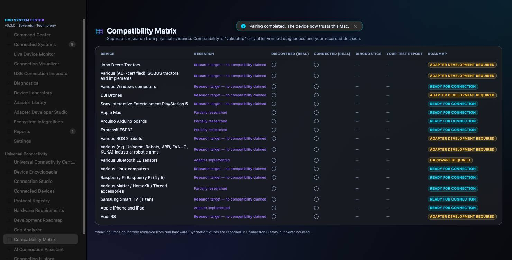 |
| Gap Analyzer | Device Encyclopedia |
| 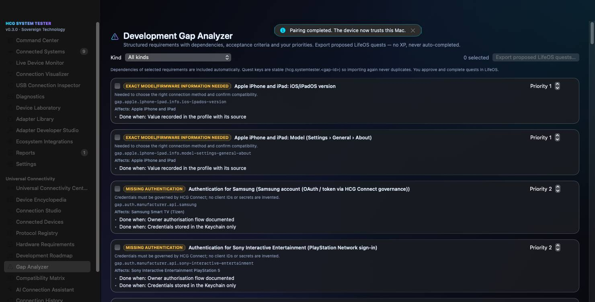 | 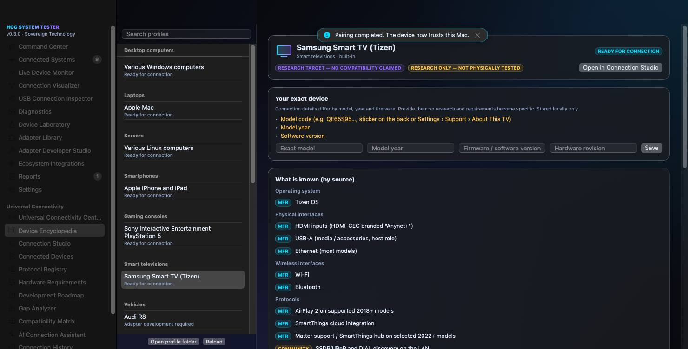 |

---

# Test results — 0.1.0

Environment: GitHub Actions `macos-15` runner (Apple silicon VM, Xcode 16, Swift 6 toolchain in Swift 5 language mode).
Workflow: `.github/workflows/macos.yml`. Run 5 (commit `8751d3b`): **all steps green**.

| Step | Result |
|---|---|
| `swift build` (debug, all 5 targets) | ✅ 41 s |
| `swift test` | ✅ 49 XCTest cases, 0 failures |
| `hcg-probe` / `hcg-probe --json` against the runner's **real IORegistry** | ✅ found 2 real USB devices (`Virtual USB Keyboard` 0x05AC:0x8105 and `Virtual USB Digitizer` 0x05AC:0x8106, both *Diagnostics available*) |
| `hcg-probe --synthetic --diagnose` | ✅ all six fixtures diagnosed; the USB 3 SSD on a USB 2 link is flagged |
| `scripts/build-app.sh --configuration release --no-sign` | ✅ `dist/HCG System Tester.app`, 55 s |
| App launched in snapshot mode (`--hcg-snapshot`) | ✅ all 10 sections rendered, live IOKit + synthetic devices, diagnostics executed, report generated |
| `xcodebuild -project App/HCGSystemTester.xcodeproj -scheme HCGSystemTester` | ✅ `BUILD SUCCEEDED` |

## Test coverage by required area

| Requirement (spec §23) | Tests |
|---|---|
| Device discovery parsing | `DiscoveryParsingTests` (IORegistry dictionaries, legacy keys, strings/Data, topology math, BCD, stable keys) + `HardwareDiscoveryTests` (live IOKit start/refresh/stop) |
| Device identification | `IdentificationTests` (controller ≠ console, storage, iPhone, Android ADB, hub, serial bridge, adapter-contributed profiles) |
| Connection state transitions | `StateMachineTests`, `InventoryTests.testDisconnectAndReattachContinuesRecord`, `testFunctionalCommunicationRequiresEvidence` |
| Adapter compatibility | `AdapterTests.testCompatibilityAndApprovalFlow`, `ExampleManifestTests` |
| Capability validation | `AdapterTests.testValidatorRejectsUnsafeManifests`, `testConfigurationSchemaValidation`, `EcosystemTests.testCapabilityRegistryIsHonest` |
| Diagnostic execution | `DiagnosticsTests.testEveryResultCarriesRequiredFields`, `testLinkSpeedDetectsDegradedLink` |
| Report generation | `ReportAndRedactionTests.testReportGenerationMarksSyntheticAndRedacts` (Markdown, JSON, `hcg.diagnostic-report/1`) |
| Device disconnection during tests | `DiagnosticsTests.testDisconnectionDuringTestsAbortsRemainingTests`, `testStabilityRecordsDropOutsWithSyntheticBackend` |
| Unsupported hardware | `IdentificationTests.testUnknownDeviceIsNotGivenCapabilities`, `DiagnosticsTests.testUnsupportedAndInapplicableTests`, `InventoryTests.testMultipleDevicesAndHonestStatuses` (Xbox GIP → Unsupported) |
| Multiple connected devices | `InventoryTests.testMultipleDevicesAndHonestStatuses`, `testTopologyFromDiscoveryOnly` |
| Permission handling | `AdapterTests.testPermissionHandling`, `DiagnosticsTests.testAuthorisationGate`, `testFaultInjectionNeverAppliesToHardware` |
| Sensitive-data redaction | `ReportAndRedactionTests.testRedactsSensitiveData`, `testRedactionRespectsSettings`, lab storage never contains raw serials |
| Navigation-only URLs | `EcosystemTests.testInboundRoutesAreNavigationOnly`, `testOutboundDeepLinksAreAllowListed` |

## Defects found by CI and fixed

1. `bcdUSB ≥ 3.2` was treated as Gen 2 capability, which would produce false "slow link" warnings on Gen 1 drives. Now
   bcdUSB ≥ 3.0 only implies SuperSpeed, and the Gen 2 limitation is stated in the result.
2. JSON exports escaped `/` in schema identifiers (`hcg.diagnostic-report\/1`). Fixed with `.withoutEscapingSlashes`.

## Not yet verified

- Physical devices on the MacBook Pro M4 Max: see [PHYSICAL-TESTING.md](PHYSICAL-TESTING.md). CI runners have no physical USB ports.
- Sidebar icons did not appear in the off-screen snapshot (`cacheDisplay` does not render source-list template images).
  On screen they render normally in standard SwiftUI; please confirm on the Mac.

## Screenshots (CI runner, real virtual USB devices + labelled synthetic fixtures)

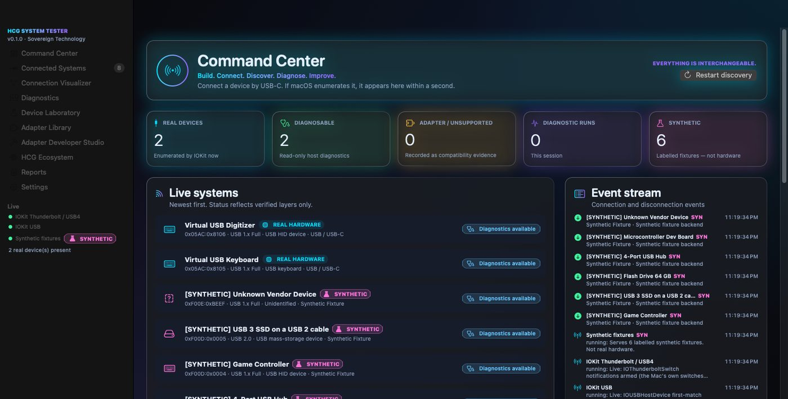
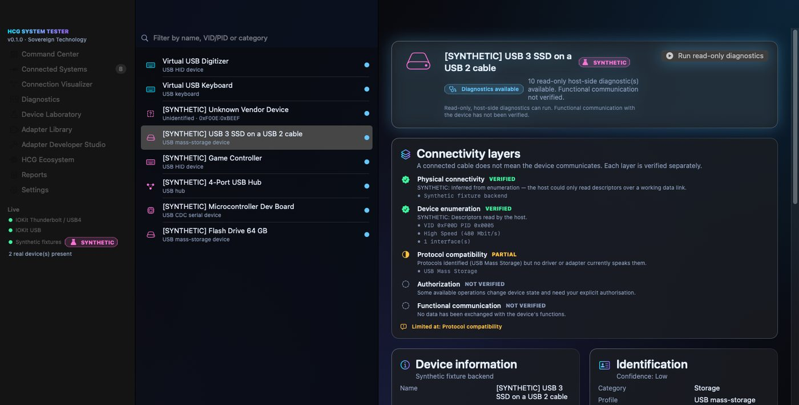
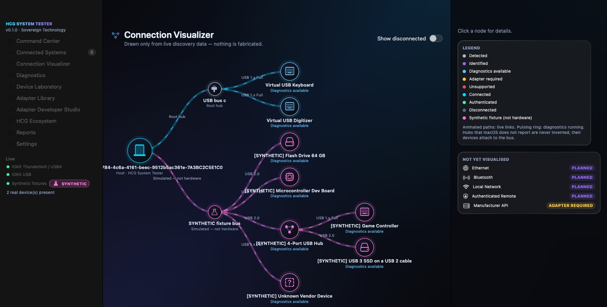
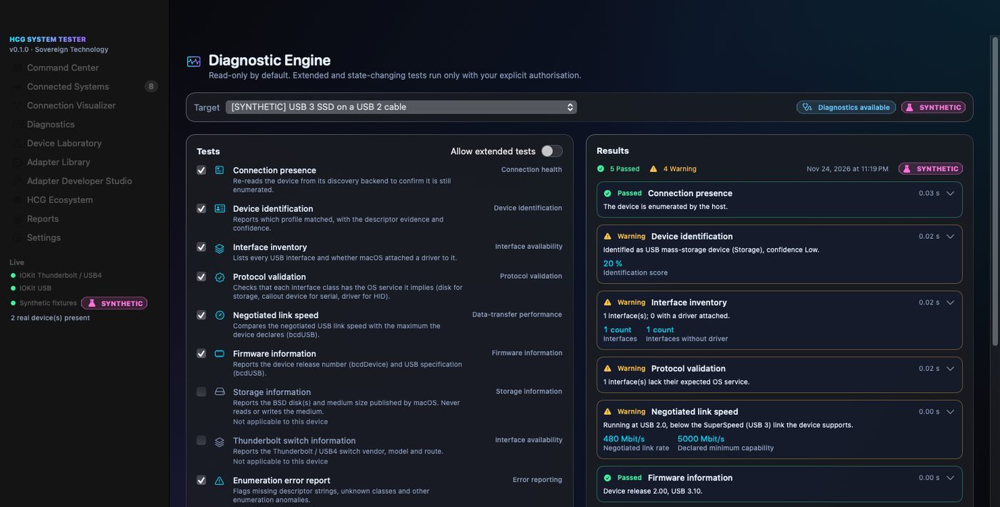
